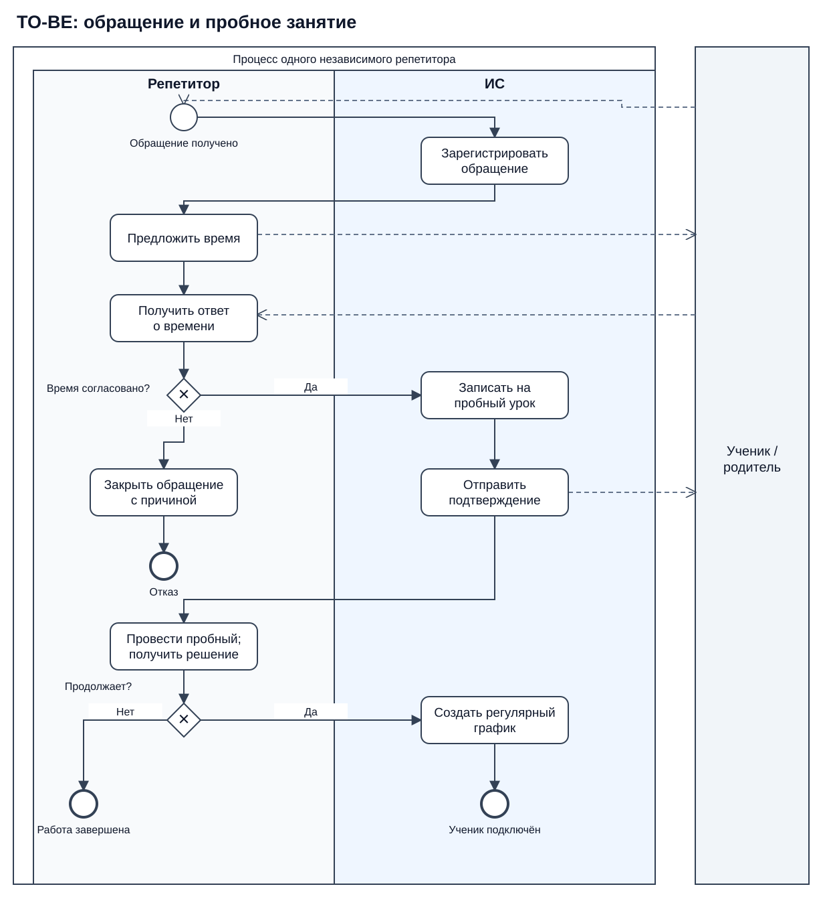
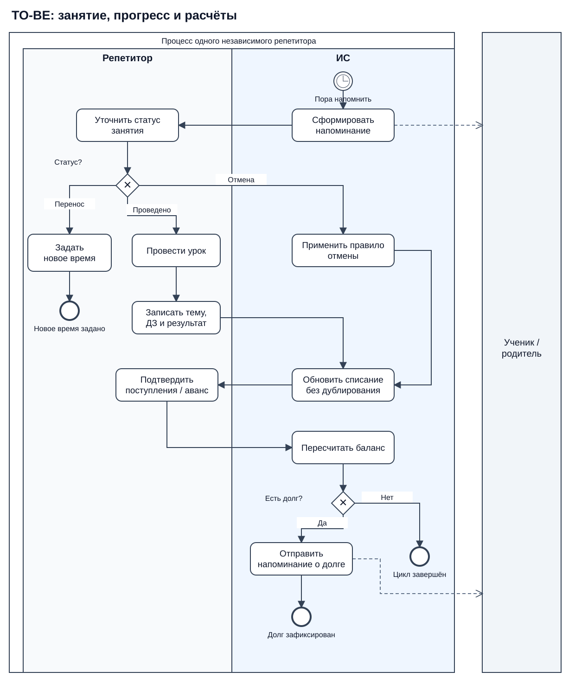

# Концепция ИС TutorIS

## Организация работы частных репетиторов

**Дисциплина:** «Проектирование информационных систем»  
**Работа:** «Разработка концепции информационной системы»  
**Ветка:** `lab1`  
**Дата:** 27 октября 2026 года

TutorIS помогает репетиторам вести учеников, расписание, занятия и оплаты. Каждый преподаватель работает со своими данными, ценами и правилами отмены. Подключение нового репетитора не должно требовать переделки программы. Так учитывается замечание преподавателя: решение нужно для многих репетиторов, а не для одного человека.

В работе сравниваем три способа организовать этот процесс, выбираем подходящий и описываем, как его внедрять и проверять.

### Команда и роли

| Участник | Роль | Основная часть работы |
|---|---|---|
| Dima51Al | Координатор | Границы проекта, требования, сборка отчёта |
| FallenAngel034 | Архитектор | Аналоги, варианты решения и ресурсы |
| QueenEnnie | Аналитик | Текущий и целевой процессы, BPMN |
| vzhuhfaka | Экономический аналитик | Затраты, эффекты и окупаемость |
| leonardoWer | Качество и безопасность | Риски и условия приёмки |

Роли предложены для работы команды. Перед сдачей нужно подтвердить распределение, вписать ФИО и учебную группу.

### Исходные условия

Рассматриваем 20 независимых репетиторов, в среднем по 25 учеников у каждого. Начинаем с пилота на пяти преподавателях. Бюджет первоначального внедрения — до 1,5 млн руб., срок до пилота — до шести месяцев.

Число пользователей, трудозатраты и ожидаемые улучшения — учебные допущения. Интервью и испытания сервиса ещё не проводились. Цены и описания аналогов взяты из открытых источников на 27.10.2026. В план внедрения включена проверка этих предположений.

### Содержание

1. Объект и требования.
2. Обзор аналогов.
3. Варианты решения.
4. Сравнение и выбор.
5. Выбранная концепция и BPMN.
6. Затраты и ожидаемый эффект.
7. Риски.
8. Качество и приёмка.
9. План внедрения и выводы.

<!-- pagebreak -->

# 1. Объект и требования

## 1.1. Как организована работа сейчас

Репетитор получает обращения, договаривается о времени, проводит занятия, выдаёт задания и следит за оплатами. Информация обычно хранится в нескольких местах: контакты и договорённости — в переписке, уроки — в календаре, оплаты — в таблице, результаты — в заметках.

**Процесс AS-IS:** обращение → запись контакта → согласование времени → пробный урок → регулярное расписание → занятие → запись темы и ДЗ → учёт оплаты → сверка долга → отчёт родителю.

При переносе урока приходится обновить календарь и переписку. После платежа — проверить перевод и отдельно изменить баланс. Отчёт по успеваемости или доходам собирается из разных записей. Это описание типового процесса по выбранной теме; фактические затраты времени нужно измерить перед пилотом.

| Участник | Что делает |
|---|---|
| Репетитор | Ведёт занятия, расписание, прогресс и расчёты со своими учениками |
| Ученик / родитель | Согласует время, оплачивает занятия, получает задания и отчёты |
| Координатор внедрения | Помогает настроить работу и обучает преподавателей |
| Поставщик сервиса | Поддерживает программу и её инфраструктуру |

Независимые репетиторы не получают доступ к общей базе учеников. Даже если один ученик занимается у двух преподавателей, их записи об уроках и оплатах остаются раздельными.

### Основные проблемы

| ID | Проблема | К чему приводит |
|---|---|---|
| P1 | Обращения остаются в переписке | Контакт забывается, договорённости приходится уточнять заново |
| P2 | Календарь и переписка расходятся | Накладки и лишние сообщения о времени |
| P3 | Нет единой истории уроков | Сложно показать прогресс и подготовить отчёт родителю |
| P4 | Оплаты не связаны с занятиями | Ошибки баланса и поздно замеченный долг |
| P5 | Напоминания отправляются вручную | Забытые сообщения и пропущенные занятия |
| P6 | Доходы каждый раз собираются заново | Лишнее время и двойной учёт |
| P7 | У каждого преподавателя свой набор файлов | Трудно подключать новых пользователей и проверять доступ |

От системы ожидаем связанный учёт: из карточки ученика можно перейти к его расписанию, истории занятий и балансу. При этом проведение урока и оценка знаний остаются задачами репетитора.

<!-- pagebreak -->

## 1.2. Функциональные требования

**Must** — обязательно, **Should** — желательно, **Could** — можно добавить позже. Для варианта с таблицами обязательный результат может достигаться вручную. Это сохраняет его как исходный вариант для сравнения; степень автоматизации оцениваем отдельно.

| ID | Требование | Приоритет | Проблема |
|---|---|---|---|
| F01 | Сохранять обращение, контакт, запрос и следующий шаг | Must | P1 |
| F02 | Назначать пробные и регулярные занятия | Must | P2 |
| F03 | Учитывать перенос, отмену и проведённый урок по установленным правилам | Must | P2, P4 |
| F04 | Хранить тему урока, ДЗ и результат проверки в истории ученика | Must | P3 |
| F05 | Считать аванс и долг по поступлениям, списаниям и возвратам | Must | P4 |
| F06 | Напоминать о занятии и оплате, показывать ошибки отправки | Should | P5 |
| F07 | Готовить отчёт о полученных доходах за период | Must | P6 |
| F08 | Выгружать учеников, уроки, результаты и финансовые операции | Must | P3, P6 |
| F09 | Подключать независимого репетитора со своими ценами и календарём | Must | P7 |
| F10 | Давать ученику или родителю доступ только к своим данным | Should | P3, P4 |
| F11 | Предупреждать о пересечении занятий | Should | P2 |
| F12 | Формировать сводку прогресса и посещаемости | Should | P3 |
| F13 | Переносить записи из таблиц и показывать ошибки импорта | Should | P7 |
| F14 | Синхронизировать календарь и автоматически сверять банковские поступления | Could | P2, P4 |

### Правила учёта

Баланс ученика: `поступления − возвраты − списания`. Положительный баланс означает аванс, отрицательный — долг. Стоимость будущего урока не списывается до предусмотренного правилами события. Повторная обработка одного урока или платежа не должна менять баланс второй раз.

Доходы за период считаются по подтверждённым поступлениям с учётом возвратов. Начисления за уроки и задолженность показываются отдельно. Например, аванс в марте и урок в апреле не создают два поступления.

При переносе отменяется напоминание о старом времени. При отказе после пробного урока обращение закрывается с причиной, без создания регулярного графика.

### Границы проекта

В работу входят организация занятий, история прогресса, расчёты и подготовка данных о доходах. Видеосвязь используется внешняя. Собственный маркетплейс, автоматическая оценка знаний, отправка налоговой отчётности и уплата налогов в первую версию не входят. Подтверждение перевода остаётся ручным, пока нет банковской интеграции.

<!-- pagebreak -->

## 1.3. Качество, ограничения и допущения

| ID | Требование | Приоритет | Цель |
|---|---|---|---|
| N01 | Разделение данных репетиторов | Must | Ни одного успешного доступа к чужим записям в контрольных сценариях |
| N02 | Управление доступом | Must | Личные учётные записи; возможность отозвать доступ |
| N03 | Копии и восстановление | Must | Потеря данных не более 24 ч (RPO); восстановление не дольше 8 ч (RTO) |
| N04 | Быстрая работа | Should | 95% открытий расписания — не дольше 2 с при 50 одновременных сеансах |
| N05 | Удобная запись урока | Should | Не более 60 с для обученного пользователя |
| N06 | Переносимость данных | Must | Читаемая выгрузка с сохранёнными связями, доступная без подписки |
| N07 | Приемлемые условия обработки персональных данных | Must | До реальных данных проверены документы, размещение и права доступа |
| N08 | Простое подключение новых пользователей | Should | 21-й репетитор подключается по инструкции без изменения программы |

Дополнительно нужны русский интерфейс, работа в браузере на компьютере и смартфоне, основное хранилище и резервные копии в России.

**Правило отбора:** вариант, который не выполняет хотя бы одно Must, нельзя внедрять, даже если он набрал больше баллов. Непроверенное свойство сначала проверяем на вымышленных данных. Для готового сервиса особенно важны экспорт, изоляция аккаунтов и восстановление.

### Допущения для расчётов

| Параметр | Принятое значение |
|---|---|
| Размер внедрения | 20 репетиторов × 25 учеников = 500 записей учеников |
| Первый пилот | 5 репетиторов |
| Расчётный период | 3 года, по 12 рабочих месяцев |
| Экономия времени в варианте B | 5 ч на репетитора в месяц |
| Стоимость продуктивного часа | 800 руб. |
| Доля времени, которую удастся использовать продуктивно | 50% |
| Сохранённые занятия за счёт лучшей организации | 0,25 урока на репетитора в месяц |
| Маржинальный эффект одного сохранённого урока | 1 000 руб. |

Расчёт за 12 месяцев упрощает сезонность. Если летом занятия сокращаются, эффект нужно пересчитать. Стоимость часа здесь — условная оценка, а не средняя зарплата репетитора.

В учебных примерах используются только вымышленные ученики. Перед работой с реальными данными проверяются условия обработки, включая данные несовершеннолетних. Подробные контрольные примеры вынесены в [приложение](attachments/acceptance-cases.md).

<!-- pagebreak -->

# 2. Обзор аналогов

Изучены четыре сервиса по страницам разработчиков [S3–S7]. Таблица показывает заявленные функции; полноценные проверки в аккаунтах ещё предстоят. Цены приведены с условиями, поэтому минимальные тарифы нельзя считать равными по составу.

| Сервис | Основные возможности | Цена и лицензирование | Интеграции и хранение | Что уточнить |
|---|---|---|---|---|
| «Мой Класс» | Ученики, расписание, посещения, оплаты, оценки и ДЗ | SaaS; PRO до 25 групп — 2 543 руб./мес. при оплате за год | Опубликованы API и webhooks; размещение нужно уточнить | Тарификация идёт по активным группам/предметам, а не просто по числу учеников |
| АльфаCRM | Занятия, клиенты, задания, баланс и кабинет клиента | SaaS; «Старт» до 100 активных клиентов — 2 600 руб./мес.; опции отдельно | Коммуникации и триггеры зависят от выбранных опций; размещение уточняется | Итоговую цену с кабинетом и уведомлениями |
| Hollihop | Расписание, продажи, финансы, коммуникации | SaaS; от 2 100 руб./мес.; полный набор зависит от тарифа | В FAQ указаны API на всех тарифах и ЦОД в России | Нужные финансовые функции и стоимость выбранного комплекта |
| Repeto | Расписание, финансы, ДЗ, напоминания, портал родителей, отчёты и правила отмен | SaaS; Standard — 490 руб./мес. до 30 активных учеников; Pro — 890 руб./мес. до 100 | Экспорт, API, размещение и восстановление в обзоре не подтверждены | Обязательные свойства до выбора поставщика |

SaaS означает готовую программу по подписке. Для независимых преподавателей предполагаем отдельные аккаунты. Филиалы внутри одной школы не считаем подтверждением того, что данные разных владельцев изолированы.

В старых описаниях «Моего Класса» встречается бесплатный тариф. По сообщению разработчика он отменён с 01.10.2026 [S4], поэтому в расчётах на него не опираемся.

Готовые сервисы уже покрывают большую часть процесса. Для расчёта варианта B берём Repeto Standard: его лимит подходит для 25 учеников и даёт низкие затраты на подписку. Это кандидат для пилота. Если не подтвердятся экспорт, восстановление или изоляция, выбираем другой сервис и пересчитываем затраты.

Описание Repeto доступно в поисковом представлении официальной страницы; полное содержимое при прямом открытии получить не удалось. Поэтому его цену и возможности нужно повторно подтвердить перед внедрением.

Эти четыре продукта относятся к одному способу решения — готовому SaaS. Далее сравниваем сам этот подход с таблицами и собственной разработкой.

<!-- pagebreak -->

# 3. Варианты решения

## A. Таблицы, календарь и общий порядок работы

Каждому репетитору выдаётся свой комплект таблиц и шаблон календаря. Вводятся правила записи обращений, проведения уроков, сверки оплат и создания копий. Баланс считается формулами, доходы выгружаются в CSV. Переносы, напоминания и отчёты родителям в основном обрабатываются вручную.

**Ресурсы:** аналитик и наставник, 32 ч, две недели. **Плюсы:** быстрый старт, низкие расходы, обычные файлы. **Минусы:** остаётся ручная сверка нескольких источников, результат сильно зависит от дисциплины преподавателя.

## B. Готовый SaaS с настройкой

У каждого репетитора отдельный аккаунт. Используется общий шаблон статусов, правил отмены, финансовых записей и выгрузки. Команда внедрения переносит данные, настраивает сервис и обучает пользователей. Неподдерживаемые входящие каналы и проверка банковского перевода остаются ручными.

**Ресурсы:** аналитик, специалист настройки, наставник и специалист по качеству с частичной занятостью; 120 ч, до шести недель до пилота. **Плюсы:** готовый интерфейс и связанный учёт без долгой разработки. **Минусы:** зависимость от поставщика, тарифа и доступных интеграций. Для расчёта используется Repeto Standard.

## C. Собственное веб-приложение

Разрабатываются кабинеты репетиторов, календарь, журнал занятий, финансовые операции, уведомления и экспорт. Укрупнённая основа: веб-интерфейс, серверное приложение, PostgreSQL, очередь уведомлений и резервное хранилище. Для начальной нагрузки достаточно одного модульного приложения.

**Ресурсы:** аналитик, два разработчика, тестировщик и специалист эксплуатации с частичной занятостью; 960 ч, около шести чел.-мес., календарный срок пять месяцев. **Плюсы:** свои правила, модель доступа и интеграции. **Минусы:** дорогой запуск и постоянная ответственность за поддержку и безопасность.

### Ресурсы и стоимость

Для единовременных работ принята учебная ставка 1 500 руб./ч. Один чел.-мес. равен 160 ч. Это оценки внедрения решения, а не времени подготовки отчёта.

| Параметр | A | B | C |
|---|---:|---:|---:|
| Трудоёмкость, ч | 32 | 120 | 960 |
| Первоначальные затраты, руб. | 48 000 | 180 000 | 1 440 000 |
| Эксплуатация за год, руб. | 156 000 | 297 600 | 300 000 |
| Стоимость за 3 года, руб. | 516 000 | 1 072 800 | 2 340 000 |
| Срок до пилота | 2 недели | 6 недель | 5 месяцев |

У A годовые расходы состоят из инструментов и хранения (60 000 руб.) и сопровождения (96 000). У C — сопровождения (180 000), инфраструктуры (96 000), копий и уведомлений (24 000). Расходы B разобраны в разделе 6.

C укладывается в начальный лимит 1,5 млн руб. почти без запаса. С резервом 15% потребуется 1 656 000 руб., поэтому объём или бюджет придётся пересмотреть.

<!-- pagebreak -->

# 4. Сравнение и выбор

## 4.1. Критерии и оценки

Для учебного сравнения приняты следующие веса. Сначала проверяем Must, затем считаем `S = Σ(вес × балл)`. Сумма весов равна 1; 5 баллов всегда означает лучший результат. Веса можно уточнить с преподавателем до внедрения.

| Критерий | Вес | A | B | C |
|---|---:|---:|---:|---:|
| K1. Покрытие требований и автоматизация | 0,25 | 2 | 4 | 5 |
| K2. Стоимость за 3 года | 0,20 | 5 | 4 | 2 |
| K3. Срок до пилота | 0,15 | 5 | 4 | 1 |
| K4. Удобство | 0,10 | 3 | 4 | 4 |
| K5. Управление защитой и восстановлением | 0,10 | 2 | 3 | 4 |
| K6. Интеграции и переносимость данных | 0,08 | 1 | 3 | 5 |
| K7. Подключение новых пользователей | 0,07 | 2 | 4 | 5 |
| K8. Независимость от поставщика | 0,05 | 5 | 2 | 5 |
| **Итог S** | **1,00** | **3,22** | **3,72** | **3,60** |

### Как выставлялись баллы

Для стоимости: 5 — до 0,6 млн; 4 — до 1,2 млн; 3 — до 1,8 млн; 2 — до 2,4 млн; 1 — больше 2,4 млн руб. Для срока: 5 — до двух недель; 4 — до шести; 3 — до десяти; 2 — до шестнадцати; 1 — дольше.

В остальных критериях оценка экспертная:

- **K1:** 2 — ручной основной процесс, 4 — автоматизирован основной цикл, 5 — предусмотрены все нужные функции и правила.
- **K4:** 3 — работа по понятным шаблонам, 4 — связанный интерфейс, 5 — удобство подтверждено пользовательской проверкой.
- **K5:** 2 — ручные процедуры, 3 — механизмы поставщика нужно подтвердить, 4 — необходимые механизмы заложены в собственный проект, 5 — подтверждены независимой проверкой.
- **K6:** 1 — обмен файлами, 3 — экспорт и типовые подключения, 5 — обмен проектируется под процесс.
- **K7:** 2 — копирование шаблонов, 4 — стандартные аккаунты, 5 — централизованное создание отдельных рабочих пространств.
- **K8:** 2 — зависимость от подписки и форматов SaaS, 5 — обычные файлы или собственный исходный код.

Высокие оценки C описывают возможности будущей разработки. Они не означают, что программа уже создана и проверена. Оценки B предполагают успешную проверку обязательных функций.

Для B: `0,25×4 + 0,20×4 + 0,15×4 + 0,10×4 + 0,10×3 + 0,08×3 + 0,07×4 + 0,05×2 = 3,72`.

<!-- pagebreak -->

## 4.2. Проверка выбора

В матрице **Р** означает ручное выполнение, **Н** — настройку или заявленную функцию, **П** — предусмотрено разработкой, **У** — нужно подтвердить до внедрения.

| Требование | A | B | C |
|---|---|---|---|
| F01–F02. Обращения и расписание | Р | Н; отдельные обращения вводятся вручную | П |
| F03. Переносы и списания | Р | Н, проверить правила | П |
| F04. История прогресса | Р | Н, проверить выгрузку | П |
| F05, F07. Баланс и доходы | Р, формулы | Н, проверить аванс и возвраты | П |
| F08, N06. Полный экспорт | Р, CSV | У | П |
| F09, N01. Раздельные данные | Отдельные папки и права | Отдельные аккаунты; проверить | П |
| N02. Доступ | Учётные записи устройства/хранилища | Н | П |
| N03. Копии и восстановление | Р, пробное восстановление | У | П |
| N07. Условия обработки данных | У, выбор хранилища | У, проверка поставщика | У, выбор инфраструктуры |
| F06, F10–F13. Дополнительная автоматизация | В основном Р | Зависит от тарифа | П |

Матрица показывает, что нужно проверить у каждого варианта. Низкая цена не компенсирует отсутствие обязательного экспорта, восстановления или изоляции.

### Анализ устойчивости

Меняем вес самого значимого критерия K1 на ±0,05. Остальные веса корректируем пропорционально: `w'_j = w_j × (1 − w'_1) / (1 − w_1)`. Их сумма остаётся равной 1.

| Вес K1 | A | B | C | Лидер |
|---:|---:|---:|---:|---|
| 0,20 | 3,3013 | 3,7013 | 3,5067 | B |
| 0,25 | 3,2200 | 3,7200 | 3,6000 | B |
| 0,30 | 3,1387 | 3,7387 | 3,6933 | B |

B сохраняет первое место. При весе K1=0,30 отрыв от C небольшой — 0,0454. Если одновременно оценка интеграций B снизится с 3 до 2, C выйдет вперёд. Значит, выбор устойчив к указанному изменению веса, но зависит от фактических возможностей SaaS.

**Выбираем B для пилота.** Он быстрее собственной разработки и лучше автоматизирует процесс, чем таблицы. Конкретного поставщика утверждаем после проверки Must. Если кандидат их не выполняет, рассматриваем другой SaaS и пересчитываем сравнение. A остаётся временным способом учёта на случай сбоя.

<!-- pagebreak -->

# 5. Выбранная концепция и BPMN

## 5.1. Обращение и пробное занятие

Каждый репетитор получает отдельный аккаунт SaaS. Для всех используется общий шаблон статусов, правил отмены, заметок о прогрессе и выгрузки. Координатор помогает с настройкой; общий доступ ко всем ученикам ему не нужен.

Подключение: создать аккаунт → настроить цены и календарь → проверить права → перенести и сверить записи → проверить выгрузку и восстановление → обучить преподавателя.

В BPMN репетитор и ИС разделены на дорожки, ученик/родитель показан отдельным пулом. Сплошные стрелки задают порядок действий, пунктирные — сообщения.

Обращение сохраняется в карточке. После согласования времени создаётся пробный урок и отправляется подтверждение. При отказе обращение закрывается с причиной. После успешного пробного занятия создаётся регулярный график.

Это устраняет P1 и часть P2: обращение и согласованное время больше не остаются только в переписке. Согласование исключений и решение о продолжении занятий остаются у преподавателя. Таймаут ответа и повторное обращение нужно описать в ТЗ отдельными сценариями.

Исходники: [draw.io](diagrams/01-intake.drawio), [BPMN 2.0](diagrams/01-intake.bpmn). Для увеличенного просмотра — [PDF схемы](diagrams/01-intake.pdf).

<!-- pagebreak -->

## 5.2. Занятие, прогресс и расчёты

Перед запланированным занятием формируется напоминание. Репетитор уточняет статус: перенос, отмена или проведённый урок. При переносе задаётся новое время и снимается старое напоминание. При отмене применяется согласованное правило списания. После урока сохраняются тема, ДЗ и результат проверки.

Начисление за урок и поступление денег учитываются раздельно. Если есть аванс, новый перевод после каждого занятия не требуется. После обновления записей пересчитывается баланс; при долге формируется напоминание.

| Проблема | Что меняется |
|---|---|
| P2. Расхождения в расписании | Перенос меняет время и связанные напоминания |
| P3. Разрозненные заметки | Результаты связаны с учеником и уроком |
| P4. Ошибки долга | Баланс считается по журналу операций |
| P5. Ручные напоминания | Сообщения планируются, ошибки отправки видны |
| P6. Смешение дохода и начислений | Отчёт строится по подтверждённым платежам |

Автоматизируются хранение записей, расчёт баланса, отчёты и поддерживаемые уведомления. Преподаватель проводит урок, оценивает знания и подтверждает перевод без банковской интеграции. Если тариф не поддерживает часть целевого процесса, это учитывается в оценке функций и экономии времени.

Исходники: [draw.io](diagrams/02-lesson.drawio), [BPMN 2.0](diagrams/02-lesson.bpmn). Для увеличенного просмотра — [PDF схемы](diagrams/02-lesson.pdf).

<!-- pagebreak -->

# 6. Затраты и ожидаемый эффект

## 6.1. Стоимость внедрения и владения

Расчёт сделан для 20 репетиторов, которые совместно оплачивают внедрение и сопровождение. Выгоду считаем со стороны пользователей. Доход поставщика от подписок сюда не входит. Компьютеры и обычные расходы на проведение уроков одинаковы для вариантов и не учитываются.

### Первоначальные затраты B

| Работа | Часы | Ставка, руб./ч | Сумма, руб. |
|---|---:|---:|---:|
| Требования и контрольные сценарии | 20 | 1 500 | 30 000 |
| Настройка аккаунтов и правил | 30 | 1 500 | 45 000 |
| Подготовка и сверка данных | 20 | 1 500 | 30 000 |
| Обучение и инструкции | 20 | 1 500 | 30 000 |
| Проверки и организация пилота | 30 | 1 500 | 45 000 |
| **Итого** | **120** | | **180 000** |

### Эксплуатация B за год

| Статья | Расчёт | Сумма, руб. |
|---|---|---:|
| Подписка [S7] | 20 аккаунтов × 490 руб. × 12 мес. | 117 600 |
| Сопровождение | 96 ч × 1 500 руб. | 144 000 |
| Дополнительные расходы на уведомления | 2 000 руб./мес. | 24 000 |
| Копии и проверка выгрузок | 1 000 руб./мес. | 12 000 |
| **Итого** | | **297 600** |

Последние три статьи — оценки команды. Дополнительные расходы на сообщения заложены даже при наличии части каналов в подписке. Порядок выгрузки и её трудоёмкость уточняются на пилоте.

Совокупная стоимость владения за три года:

`TCO = первоначальные затраты + 3 × годовые расходы`.

`TCO_B = 180 000 + 3 × 297 600 = 1 072 800 руб.`

Можно предусмотреть резерв 15% первоначальных затрат — 27 000 руб. Если он будет полностью израсходован, TCO составит 1 099 800 руб., а ROI снизится примерно до 35,0%. В базовом расчёте этот резерв не расходуется.

Расчёты доступны в [Python-скрипте](calculations/calculate.py), результаты — в [JSON](calculations/results.json), помесячная таблица — в [CSV](calculations/cashflow_b.csv).

<!-- pagebreak -->

## 6.2. Эффект, окупаемость и сценарии

Потенциальная экономия времени: `20 × 5 ч × 12 × 800 руб. = 960 000 руб./год`. Предполагаем, что продуктивно получится использовать половину времени: **480 000 руб./год**. Это возможность дополнительной работы, а не автоматическое снижение расходов.

Сохранённые занятия: `20 × 0,25 × 12 × 1 000 руб. = 60 000 руб./год`. Они относятся к ранее потерянным из-за организации урокам и не дублируют новые занятия в освободившиеся часы.

Полный эффект B — **540 000 руб./год**. Первые шесть месяцев он составляет 50%, затем — 100%. За первый год получаем 405 000 руб., за второй и третий — по 540 000 руб.

`ROI = (эффект за 3 года − TCO) / TCO × 100%`.

`ROI_B = (1 485 000 − 1 072 800) / 1 072 800 × 100% = 38,42%`.

Упрощённая окупаемость при немедленном полном эффекте: `180 000 / (540 000 − 297 600) = 0,743 года`, около 8,9 месяца. **С учётом постепенного выхода на полный эффект — 15,6 месяца.** Первые шесть месяцев чистый результат равен −2 300 руб./мес., затем +20 200 руб./мес.

| Вариант | Полный эффект/год, руб. | TCO за 3 года, руб. | Эффект за 3 года, руб. | ROI |
|---|---:|---:|---:|---:|
| A | 108 000 | 516 000 | 297 000 | −42,44% |
| B | 540 000 | 1 072 800 | 1 485 000 | 38,42% |
| C | 588 000 | 2 340 000 | 1 617 000 | −30,90% |

Для A приняты 1 ч экономии и 0,05 сохранённого урока на репетитора в месяц; для C — 5,5 ч и 0,25 урока. Стоимость часа и доля его использования одинаковы. У всех вариантов учтены первые шесть месяцев на 50% эффекта; период начинается после готовности к пилоту.

| Сценарий B | Часы/мес.; цена часа; доля использования; сохранённые уроки/мес. | Эффект/год, руб. | ROI за 3 года | Окупаемость |
|---|---|---:|---:|---|
| Пессимистичный | 3; 600 руб.; 30%; 0,10 | 153 600 | −60,63% | За 3 года нет |
| Базовый | 5; 800 руб.; 50%; 0,25 | 540 000 | 38,42% | 15,6 мес. |
| Оптимистичный | 6; 900 руб.; 60%; 0,40 | 873 600 | 123,94% | 8,3 мес. |

При прочих базовых условиях трёхлетний результат станет отрицательным, если продуктивно используется меньше **34,39%** сэкономленного времени, подписка стоит больше **1 062,50 руб./аккаунт/мес.** или подключено меньше **13 репетиторов** при прежних общих расходах. Без использования освободившегося времени эффект — лишь 60 000 руб./год, и внедрение не окупается. Инфляция и дисконтирование в учебной модели не учитываются.

<!-- pagebreak -->

# 7. Риски

Вероятность P и влияние I оцениваются от 1 до 5; `R = P × I`. Уровень 1–7 — низкий, 8–14 — средний, 15–25 — высокий. Оценки предварительные. Остаточный риск — цель после выполнения мер.

| ID | Риск / категория | P | I | R | Что делаем | Ответственный | Остаточный R |
|---|---|---:|---:|---:|---|---|---:|
| R1 | Чужие данные видны пользователю / ИБ | 3 | 5 | 15 | Снизить: отдельные аккаунты; проверить ссылки, поиск и выгрузку; при дефекте остановить ввод | leonardoWer | 5 |
| R2 | Неприемлемые условия обработки или хранения / правовой | 3 | 5 | 15 | Избежать: проверить документы и размещение до реальных данных; при отказе сменить сервис | Dima51Al | 5 |
| R3 | Нельзя выгрузить историю или восстановиться / технический | 4 | 4 | 16 | Снизить: полный экспорт, независимые копии, пробное восстановление | FallenAngel034 | 8 |
| R4 | Преподаватели не ведут записи / организационный | 4 | 4 | 16 | Снизить: обучение, пилот на пяти участниках, проверка полноты журнала | QueenEnnie | 8 |
| R5 | Сервис недоступен перед уроком / технический | 3 | 4 | 12 | Снизить: актуальная копия расписания и контактов; временный ручной журнал | FallenAngel034 | 6 |
| R6 | Подписка дорожает / финансовый | 3 | 4 | 12 | Снизить: раз в квартал пересчитывать TCO и сравнивать с порогом цены | vzhuhfaka | 6 |
| R7 | Напоминание не доставлено или продублировано / интеграционный | 4 | 3 | 12 | Снизить: журнал ошибок, отмена старых сообщений, резервная ручная связь | QueenEnnie | 6 |
| R8 | Ошибки начальных балансов / данные | 3 | 4 | 12 | Снизить: сверить записи и суммы до и после переноса | vzhuhfaka | 4 |
| R9 | Экономия времени ниже расчётной / экономический | 4 | 4 | 16 | Снизить: замеры до/после; не расширять пилот при отрицательном результате | vzhuhfaka | 8 |
| R10 | Поддержку знает только один человек / организационный | 3 | 3 | 9 | Снизить: инструкции, второй ответственный, передача знаний | Dima51Al | 6 |

Высокие риски R1–R4 и R9 проверяются до расширения пилота. Раз в неделю команда обновляет оценки и отмечает выполненные меры. Для R3, R4 и R9 контроль продолжается и после запуска.

При раскрытии чужих данных или неприемлемых условиях обработки работа с реальными записями приостанавливается. Отсутствие обязательного экспорта или восстановления также требует смены решения, а не принятия риска ради низкой цены.

<!-- pagebreak -->

# 8. Качество и приёмка

Ниже — цели будущих проверок. Испытания начинаются на вымышленных данных. Нагрузку и способ восстановления SaaS заранее согласуем с поставщиком.

| ID | Показатель | Как проверяем | Требования |
|---|---|---|---|
| Q1 | Ни одного раскрытия чужих данных | 30 отрицательных сценариев для двух репетиторов и двух семей: ссылки, поиск, вложения, экспорт и отзыв доступа | N01, N02 |
| Q2 | Все балансы и доходы совпадают с эталоном | 20 примеров: аванс, долг, перенос, отмена, возврат, повторная обработка; сверка до рубля | F03, F05, F07 |
| Q3 | Все ключевые записи выгружены, связи не потеряны | 500 учеников, 2 000 уроков, 1 000 финансовых операций и заметки; сверка ID, количества и сумм | F04, F08, N06 |
| Q4 | RPO ≤ 24 ч, RTO ≤ 8 ч | Имитировать потерю тестовых данных или доступа и восстановить работу; измерить время и потери | N03 |
| Q5 | 95% открытий расписания ≤ 2 с | 500 измерений при 50 сеансах и объёме данных из Q3; ошибки тоже учитываются | N04 |
| Q6 | ≥ 95% уведомлений переданы провайдеру за 5 мин; нет сообщений на отменённое время | 100 событий, включая 20 переносов/отмен; сверка журнала отправки | F06 |
| Q7 | Медиана записи урока ≤ 60 с; ≥ 90% действий без помощи | 5 обученных преподавателей, по 10 действий; отдельно проверить настройку нового кабинета | F02, F09, N05, N08 |

Передача уведомления провайдеру не означает, что ученик его прочитал. Ошибка должна быть видна репетитору. Если нельзя восстановить рабочий аккаунт, проверяем другой способ продолжить учёт по связанной выгрузке в пределах RTO.

### Порядок приёмки

1. **Предварительная проверка:** условия хранения, Must, контрольные расчёты, права, экспорт и восстановление. Результат — список дефектов и протокол.
2. **Пилот:** пять репетиторов, четыре недели; журнал ошибок, замеры времени и расходов.
3. **Повторная проверка и решение:** после исправлений повторить Q1–Q7, показать полный процесс и пересчитать экономику. Оформить протокол и акт приёмки либо причины отказа.

За проверки отвечает leonardoWer; QueenEnnie собирает пользовательскую обратную связь, FallenAngel034 проверяет технические условия, vzhuhfaka — расчёты. Dima51Al координирует решение.

Приёмка возможна после выполнения всех Must и устранения критических ошибок доступа, балансов и выгрузки. Отклонения Q5–Q7 обсуждаются отдельно с пересчётом эффекта. В [приложении](attachments/acceptance-cases.md) приведены финансовые примеры и форма протокола.

<!-- pagebreak -->

# 9. План внедрения и выводы

Сроки отсчитываются от решения продолжить проект. Подготовка к пилоту занимает до шести недель; полная приёмка и расширение идут позже.

| Период | Работа | Ответственный | Результат |
|---|---|---|---|
| Неделя 1 | Проверить исходные условия на пяти репетиторах, уточнить требования | Dima51Al, QueenEnnie | Требования и исходные замеры времени |
| Неделя 2 | Подготовить ТЗ; проверить сервис, документы, экспорт и восстановление | FallenAngel034, leonardoWer | Решение о допуске или замене кандидата |
| Неделя 3 | Настроить аккаунты, правила и уведомления | FallenAngel034 | Тестовые кабинеты |
| Неделя 4 | Обучить участников, проверить Q1–Q7 и перенос данных | QueenEnnie, leonardoWer | Инструкции и протокол |
| Недели 5–8 | Провести пилот на пяти репетиторах | Dima51Al, вся команда | Отчёт по пилоту |
| Недели 9–10 | Исправить ошибки, повторить проверки | leonardoWer, vzhuhfaka | Решение о приёмке |
| Недели 11–12 | Подключить остальных до 20 репетиторов | Dima51Al, QueenEnnie | Работа в полном масштабе |
| Месяцы 4–6 | Сверить фактический эффект и расходы | vzhuhfaka | Обновлённый бизнес-кейс |

### Дополнительные показатели результата

Исходные значения ниже — допущения для постановки целей. Перед пилотом заменяем их фактическими замерами.

| Показатель | Сейчас, допущение | Цель и измерение |
|---|---|---|
| Потерянные обращения | 10% | ≤ 2%; сверить входящие и зарегистрированные за 4 недели |
| Полнота журнала | 60% | ≥ 95% уроков с темой и результатом на следующий день |
| Ошибки баланса | 5% карточек | ≤ 1%; ежемесячно сверять не менее 50 карточек |
| Подготовка сводки родителю | 15 мин | ≤ 5 мин; медиана по 20 запросам |
| Самостоятельное подключение | Нет общей инструкции | 4 из 5 участников проходят инструкцию без разработчика |

### Вывод

Для выбранного масштаба подходит **B — готовый SaaS с отдельными аккаунтами**. Он набрал 3,72 балла против 3,60 у собственной разработки и 3,22 у таблиц. Базовая модель даёт ROI 38,42% за три года и окупаемость 15,6 месяца с учётом постепенного роста эффекта.

Сначала нужно подтвердить Must и проверить выгоду на пяти репетиторах. При плохих результатах меняем сервис или пересматриваем решение. В ТЗ переходят требования F01–F14 и N01–N08, правила учёта, модель доступа, экспорт и проверки Q1–Q7.

<!-- pagebreak -->

# Источники и приложения

Веб-источники просмотрены 27.10.2026. Возможности сервисов приведены по описаниям разработчиков, расчёты выполнены по допущениям этой работы.

| ID | Источник | Для чего использован |
|---|---|---|
| S1 | «Методические указания. Разработка концепции информационной системы», предоставленный PDF | Структура работы и методы сравнения, расчётов, оценки рисков и приёмки |
| S2 | «Лекция по нормативке», предоставленный PDF | Назначение нормативных документов и связь стадий разработки |
| S3 | [«Мой Класс»: тарифы](https://moyklass.com/prices) | Лицензирование и цена PRO до 25 групп |
| S4 | [«Мой Класс»: дайджест за III квартал 2026](https://moyklass.com/blog/digest_q3) | Изменение бесплатного тарифа и работа с журналом |
| S5 | [АльфаCRM: тарифы](https://alfacrm.pro/pricing) | Начальная цена и дополнительные опции |
| S6 | [Hollihop: FAQ](https://holyhope.ru/faq) | Цена, API, размещение и внедрение |
| S7 | [Repeto: официальный сайт](https://www.repeto.ru/) | Функции и тариф Standard; условия требуют подтверждения |
| S8 | Письмо преподавателя от 21.10.2026, предоставленный скриншот | Требование применимости для многих репетиторов |

По методичке работа относится к стадии разработки концепции по ГОСТ Р 59793-2021. Для следующего этапа указаны ГОСТ 34.602-2020 и ГОСТ 34.201-2020; редакции и применимость уточняются при подготовке ТЗ. Условия обработки персональных данных и требования 152-ФЗ проверяются до работы с реальными записями.

### Приложения

| Материалы | Где находятся |
|---|---|
| Две BPMN-схемы, редактируемые исходники и PDF | `diagrams/01-intake.*`, `diagrams/02-lesson.*` |
| Расчёт оценок, устойчивости и экономики | [calculate.py](calculations/calculate.py), [results.json](calculations/results.json) |
| Помесячный результат B | [cashflow_b.csv](calculations/cashflow_b.csv) |
| Финансовые примеры и проверки Must | [acceptance-cases.md](attachments/acceptance-cases.md) |
| Тезисы защиты на 8–10 минут | [defense.md](attachments/defense.md) |
| Проверка по методичке | [checklist.md](attachments/checklist.md) |

Основной отчёт занимает 16 страниц с титульной страницей и источниками. Приложения хранятся отдельно.
